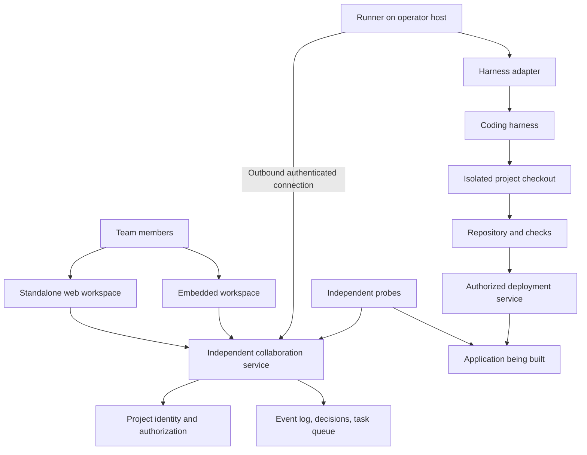

# Collaborative development workspace

**Status:** Design proposal, October 30, 2026. No implementation or deployment is authorized by this document. Working title; product name undecided.

## Purpose

Give a small team a shared place to build software with a coding agent. Everyone can see who asked for a change, discuss it together, understand what the agent is doing, and connect the result to a running product.

The simplest expression of the product is: **“These are the people I want to build with. Give us a shared workspace and a coding agent.”**

The workspace runs independently of the application being built. Teams can open it directly or embed it in their application. It supports a choice of coding harness, with an adapter boundary that permits more than one harness over time.

This proposal synthesizes the supplied discussion without importing its private transcript, screenshots, unrelated messages, or personal details. The architecture and sequencing below are recommendations, not claims that the group approved every detail. It does not assess competing products, provider account-sharing rules, or app-store eligibility.

## What the discussion establishes

| Theme | Product direction | Question still open |
| --- | --- | --- |
| Shared visibility | A named, chronological view of team requests, discussion, and builder updates | Which conversations may remain private? |
| Shared context | The agent should see the debate behind a decision, not just isolated instructions | One underlying session, multiple sessions, or a combination? |
| Harness choice | A web interface for the team's preferred coding harness | Which second harness proves the abstraction? |
| Independence | The builder should remain accessible when the application breaks | How much infrastructure must be independent initially? |
| Embedded access | Keep the builder close to where people use the product | Which integration gives the smallest reliable installation? |
| Operational visibility | Show uptime, latency, deployments, and product analytics | Which measurements are essential for the first release? |
| Cost awareness | Make usage visible and avoid endless unattended work | What project budgets and approval thresholds should be defaults? |

There was a real alternative in the discussion: a separate thread per person. The recommendation is to start with a shared project room and a single coordinating session, then revisit execution parallelism based on observed queueing and context problems. A person’s identity and authority must remain explicit even when their messages share one context window.

## First users and scope

The first users are small, trusted teams building a shared web application: friends making a project, a research group making an internal tool, or a small organization maintaining several bespoke apps. Porchday is the first integration, not a dependency every project must adopt.

**MVP includes:** one project room per project; named participants; discussion and explicit build requests; one supported harness; one registered execution host per project; a durable work queue; plan/review controls; change and deployment records; a mobile-friendly standalone UI; the same UI embedded in a host application; basic health and usage views; and operator pause/recovery controls.

**Later:** a second production harness, simultaneous workers in isolated worktrees, optional per-person private conversations, cross-project search, richer analytics, external messaging connectors, and a public integration ecosystem.

**Not an MVP goal:** a full IDE, real-time collaborative text editing, arbitrary autonomous agents managing each other, importing all existing private chats, native app-store distribution, or a promise of uninterrupted operation during every provider outage.

## Experience

### Join a project

An operator connects a repository, registers a runner, chooses a supported harness and environment, and invites teammates. Each person signs in with their own identity. The operator configures who can discuss, request builds, approve changes, deploy, and manage membership.

A project can use an operator-managed execution account or another supported credential arrangement. Members never need the operator’s password or session. Whether a provider permits a particular execution/account arrangement is an integration requirement to verify, not something implied by calling it a shared window.

### Talk together, then build

The project opens to **Room**, a chronological conversation with human names and clearly labeled agent messages. Members can reply to specific messages, mention teammates, and mark a message as a question, proposal, bug, or build request. Ordinary discussion does not silently launch a coding run.

The agent can answer an explicit question or prepare a requested plan. A plan includes the intended behavior, affected components, acceptance criteria, risks, estimated work, and requested capabilities. Once the project’s policy is satisfied, the server creates an authorized task from that exact plan version.

A task card shows the requester, plan, queue position, current state, progress, relevant changes, checks, and deployment state. The interface distinguishes **implemented**, **tested**, **deployed**, and **verified**. It never translates “the agent finished speaking” into “the change is live.”

### Follow the team

**Activity** is the global project view: named requests, decisions, task transitions, accepted changes, deployments, and rollbacks. Filters select a person, task, environment, or event type; they do not change access permissions.

The default room is shared with project members from the moment a message is sent. Existing private builder conversations stay private. Publishing a prior conversation requires an explicit preview and deliberate sharing action; no historical transcript is made public simply because a shared view was added. Membership and history visibility must be shown before joining and posting.

“Global” means project-wide, not public across all projects or everyone on the internet. A friends-based feed can be an optional host-product integration later; friendship does not grant development authority.

### Inspect and recover

**Changes** links requests to plans, commits, checks, artifacts, releases, and reverts. **Health** shows production/staging availability and latency, the deployed revision, runner connectivity, queue delay, and usage. Analytics are separate, aggregated product measurements; private product content is not automatically available to the builder.

The same room and controls are available through the standalone site and embedded panel. When the host application is down, the team opens the standalone site, sees the incident, and can request a diagnosis or authorized rollback without logging into the broken application.

On mobile, Room, Activity, Changes, and Health remain first-class navigation destinations. No essential capability is desktop-only or hidden behind a hover interaction.

## Shared conversation, controlled execution

Use **one canonical project event log** and initially **one coordinating harness session per project**. These are distinct: the log is durable product state; a model session is a replaceable execution aid.

Every human message carries an authenticated actor ID, project ID, visibility, timestamp, and reply reference. A request additionally carries a stable task ID. The server, not the model or message body, supplies role and authorization metadata.

At task start, assemble a context package containing the approved request, relevant discussion, current decisions, unresolved objections, repository revision, active work, and project policy. Preserve disagreement and its resolution in decision records with references to source events. Summaries can compress old discussion, but must not silently erase dissent or turn suggestions into authorization.

If teammates disagree while a task is running, pause before the disputed irreversible step and record the conflict. New messages do not automatically rewrite an approved plan. Significant scope changes produce a new plan version and invalidate prior approvals for that scope. Questions and harmless discussion can continue while implementation is queued.

A later parallel execution mode can delegate bounded tasks to separate sessions and worktrees. Their outputs return as artifacts and summaries, not competing edits to a shared checkout. Merge and deployment remain serialized per target environment. Cross-session coordination is permitted only within capabilities explicitly granted by the project and supported by the selected harness; this design does not bypass a harness's own permission rules.

## Architecture

The collaboration service owns identities, membership, room events, task authorization, queue state, and audit history. A runner owns local execution. The harness performs coding work. A deployment service enforces release policy. Initially these may be modest services on existing infrastructure, but their responsibilities and credentials remain separate.

The host application must not be the only identity provider or database for the standalone workspace. Use a separate origin, deployment, datastore, and operator recovery path. The builder should also avoid requiring a working host app to obtain repository or deployment access. Shared infrastructure providers remain common failure risks; the first release promises independence from application failures, not from every cloud failure.

The existing Porchday bridge is useful prior art: outbound runner polling, serialized access, progress streaming, attribution, and ordinary revert commits. Its [design](builder-chat.md) and [installation guide](../apps/builder-bridge/README.md) describe an application-coupled bridge. Reuse ideas and tested pieces after inspection; do not equate extraction with copying its authentication, data model, or provider-specific session handling unchanged. Historical design documents are not proof of current runtime configuration.

## Harness adapter contract

The platform owns a normalized interface, not a fictional common provider API:

| Operation | Required behavior |
| --- | --- |
| Discover capabilities | Report supported session, streaming, cancellation, usage, approval, and artifact features |
| Start/resume task | Accept a task ID, workspace revision, context package, and authorized capabilities; return an execution reference |
| Stream events | Emit ordered text/progress/artifact/state events with replay cursors and task attribution |
| Request human input | Preserve provider approval/input requirements and route them to an authorized person |
| Cancel | Attempt a stop and report whether termination is confirmed; never assume that an HTTP acknowledgment stopped the process |
| Reconcile | Determine whether an interrupted execution completed, remains active, or has an unknown outcome |
| Report usage | Return measured usage when available, estimates explicitly labeled, and “unavailable” when unsupported |

Each adapter has contract tests. Unsupported functionality is visible rather than simulated as success. Switching harnesses starts a new execution context from the platform’s authorized records; portability of opaque provider sessions is not promised. Ship the first adapter before expanding support, then validate the abstraction with a second implementation.

## State, concurrency, and recovery

Core entities are `Project`, `Membership`, `RoomEvent`, `Decision`, `PlanVersion`, `Approval`, `Task`, `Run`, `RunnerLease`, `Artifact`, `Deployment`, and `UsageRecord`. External identifiers are scoped to a project and provider. Task/run IDs connect every change and result back to its request.

A task moves through `proposed → awaiting_approval → queued → running → verifying → completed`. Additional states include `waiting_for_input`, `paused`, `failed`, `cancelled`, and `outcome_unknown`. Deployment has its own status; successful tests do not mark it deployed.

Use at-least-once message delivery with idempotent submission keys and a database-backed lease with monotonically increasing fencing tokens. Only the current lease holder may publish execution results or request a deploy. Lease expiry does not prove an old local process stopped: quarantine its checkout, confirm termination or isolate it, and reconcile side effects before a replacement run can write.

After a crash, compare task records, commit trailers, deployment receipts, and provider execution status. Do not blindly replay an action that may already have sent a message, changed infrastructure, or deployed. Unknown results become visible operator work. Keep the conversation usable while execution is blocked.

Undo produces ordinary revert commits linked to the original task. Database changes must remain compatible with the preceding app release. A deployment rollback and a source revert are separate operations, both recorded; neither promises to reverse irreversible external actions.

## Authorization and privacy

Project membership grants visibility according to an explicit policy. Suggested roles are viewer, contributor, approver, and operator; small teams can assign several roles to the same person. Discussion participants do not acquire deploy or secret access through persuasive text.

Projects select a policy for changes: operator approval, designated reviewers, or voting. Porchday’s existing web-feature rule remains a host policy: a published plan, net +3, and a server-issued approved implementation task. Bug fixes and desktop operator requests retain their own rules. The new product must not silently replace those semantics with a generic “trusted teammate” flag.

Approval is bound to plan version, capability scope, repository, and target environment, and checked again immediately before an external action. Revoking access cancels queued work and prevents subsequent privileged actions; it cannot reverse actions already completed.

Treat repository files, screenshots, imported messages, tool output, and external sites as data, not authorities. Keep secrets in a runner/deployment credential store; provide narrow capabilities when possible. Members receive readable updates and reviewed artifacts, not automatic dumps of commands, environment variables, raw logs, or hidden model reasoning. Artifact access follows project membership and visibility rules.

Shared room contents are visible to the service operator and whichever model provider processes them; do not claim end-to-end encryption from those processors. Provide retention/export controls, disclose provider processing, and define how membership revocation affects history access. Deletion cannot retract provider processing, exported copies, or already published commits. Keep audit metadata useful without retaining secret values.

## Embedding and integrations

Start with an iframe on a dedicated builder origin plus a small integration API. The standalone site serves the same UI. A later SDK can offer deeper customization once the boundary is proven.

The host exchanges an authenticated identity assertion for a short-lived, project-scoped session through a trusted server path. The service validates issuer, audience, expiry, nonce, and membership. Never accept a browser-supplied handle as identity. Use explicit allowed origins for embedding and messaging; validate `postMessage` origins and payloads. No project credential goes into the host page or a URL.

Test third-party cookie restrictions on mobile browsers. If embedding cannot establish a session reliably, offer “Open workspace” with a safe top-level sign-in flow. Standalone login must remain available during a host outage.

Proposed integration surfaces cover submitting requests, subscribing to authorized progress, reading project activity, linking release/health events, and retrieving reviewed artifacts. Webhooks are signed, replay-protected, and idempotent. The API does not expose arbitrary shell execution. A Signal or other messaging connector is a later adapter with explicit identity and sharing rules, not an automatic import of personal conversations.

## Usage and operational dashboard

Display queue wait, execution time, provider usage where available, estimated cost, and budget remaining per project. Label account-wide provider limits separately from project estimates. Never imply exact dollar costs when the provider does not supply sufficient data.

Runs need bounded wall time, retry count, and permitted scope. Projects have configurable daily/monthly budgets and concurrency limits. Reserve an estimated budget before starting; pause safely at a checkpoint when the limit is reached. Do not silently buy credits or switch to a paid fallback. Escalation requires an authorized explicit action.

Avoid permanent agent polling loops: trigger work from durable events, use backoff for transient failures, and keep ordinary health monitoring in inexpensive deterministic probes. Show why a task is waiting: another task, approval, runner outage, provider quota, or budget.

Health measurements include probe location, timestamp, stale-data status, error rate, latency percentiles, release revision, and runner heartbeat. Uptime claims require a defined measurement window and denominator. Product analytics are opt-in aggregate signals, not a back door into application content.

## Delivery plan and acceptance

| Phase | Deliverable | Exit evidence |
| --- | --- | --- |
| 0: Design and boundaries | Confirm shared-room policy, project roles, first harness, execution host, budget defaults, and independent login | Reviewed decisions and an agreed narrow pilot |
| 1: Shared workspace | Named room, discussion/request distinction, task queue, one adapter, progress, attribution, cancellation | Two teammates discuss and complete one change; simultaneous requests cannot race shared writes |
| 2: Independent access | Standalone service and embedded UI with separate identity/recovery path | Disable the host app; team can still sign in, inspect state, and invoke an authorized recovery action |
| 3: Release and usage | Checks, release receipts, reversions, health, quotas, and budget pauses | Bad change is reverted with traceable evidence; exhausted budget pauses without losing work |
| 4: Porchday pilot | Opt-in integration preserving existing approvals, privacy, and rollback behavior | Desktop/mobile journey and operator recovery drill pass; no private-history migration without consent |
| Later, separately scoped | Second harness, parallel workers, external chat connectors, richer analytics | Adapter/authorization tests and a new rollout decision for each expansion |

Before calling the pilot ready, demonstrate: reconnecting clients receive events without duplicate tasks; a runner crash does not duplicate a deployment; stale workers cannot publish results; permission revocation blocks the next privileged action; a changed plan cannot reuse old approval; a secret-like output is withheld; an unauthorized member cannot read another project; budget exhaustion produces an understandable state; and both desktop and mobile users can find the shared activity view.

## Decisions to make next

1. Is every new project conversation shared by default, with no private channels in the MVP? **Recommendation: yes, with explicit onboarding disclosure.**
2. Do we start with one coordinating session per project? **Recommendation: yes; keep the durable event log independent of it.**
3. Where should the service run? **Recommendation: separate deployment and storage from Porchday; outbound runner on the existing operator host for the first pilot.**
4. Which change policy should a new non-Porchday project use? **Recommendation: a designated approver initially; let Porchday keep its voting policy.**
5. What must work during an outage? **Recommendation: independent sign-in, conversation, state inspection, pause, and an authorized rollback path.**
6. What provider/account arrangement and first budget are acceptable? **Unresolved; verify supported execution before implementation.**
7. Should this become a separate repository immediately? **Recommendation: once the design is accepted, build the platform in its own repository and treat Porchday as its first integration. This document alone does not create that repository.**

The first milestone is a small team successfully discussing, authorizing, shipping, and undoing one change through a shared room—even when the target application is unavailable.
