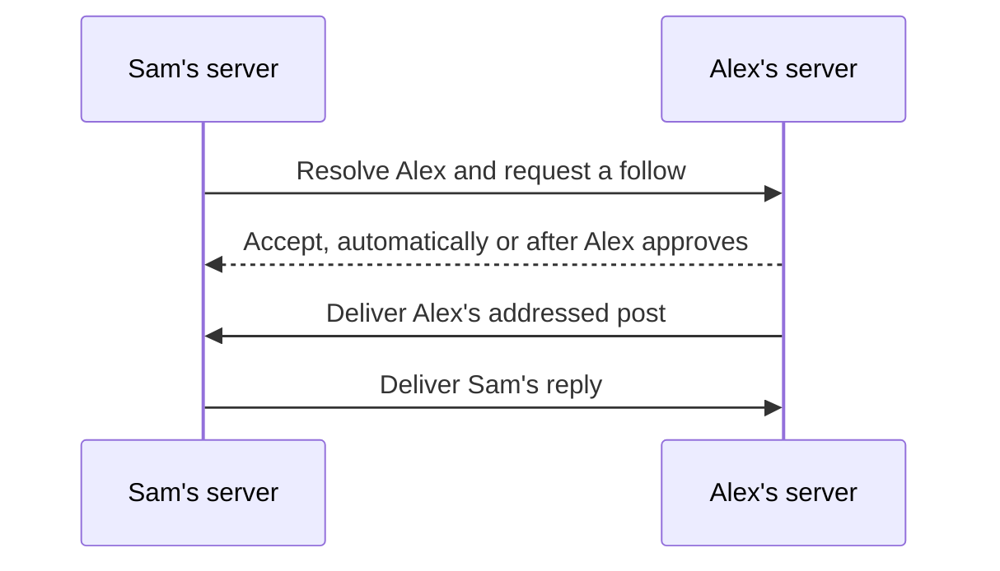
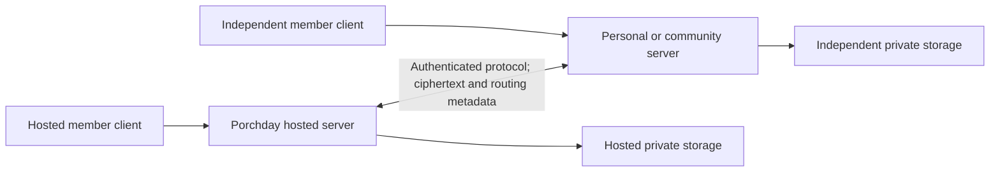

# Porchday federation proposal

Status: discussion draft, October 26, 2026. This proposes future work, not implemented federation or a change to the current pilot. The product remains Porchday. Protocol names, endpoints and wire formats below are candidates for review.

Tracking: [design issue #20](https://github.com/porchday/porchday/issues/20). The existing [six-user validation plan](https://github.com/porchday/porchday/issues/19) provides a starting point for later cross-server tests.

## Proposal in brief

Let people participate in the same private social network while choosing who operates their server. Porchday's nonprofit-hosted service remains the default. Someone operating a personal or small community server can connect with people on the hosted service or another compatible server, exchange friend requests, and share encrypted posts, photos, comments and reactions.

Keep the ordinary hosted experience unchanged: sign up, find people, accept requests, and read a chronological feed. No server selection during signup, federated username syntax, public server directory, or requirement to understand where a friend is hosted. People who want this capability can open **Settings → Advanced → Other servers**, enter a server address, then find or invite a particular person there. A normal invitation link should make even that setup unnecessary for its recipient.

Confirmed scope for this proposal: support both personal and small community servers, and target interoperability among Porchday-compatible servers first. Compatibility with Mastodon or other existing networks is outside the initial target. Protocol selection and the remaining tradeoffs below are still open.

The difficult part is preserving privacy and lifecycle behavior across independent operators. The current application can atomically check relationships, device keys and publication recipients in one database. A distributed system cannot simply copy that logic into an outbound queue and retain the same guarantees. Federation needs an explicit authorization, identity and failure model before implementation.

## Product boundaries

| Preserve | Add behind advanced settings | Leave outside the first experiment |
| --- | --- | --- |
| Hosted signup and ordinary names/handles | Add a compatible HTTPS server or use a person invitation | Global people/server search and public social graphs |
| Mutual friends, family classification, 300 connections total | Connect to a specific person across servers | Followers, public broadcast feeds or trending |
| Chronological feed and personal walls | View hosting and identity details when needed | Transparent plaintext bridges to other networks |
| Client-encrypted private content and human-operated accounts | Operate a personal or community server | Anonymous servers without an accountable operator/contact |
| Photos, nested comments, multiple reactions and inherited deadlines | Export/move an account with an explicit continuity procedure | Automatic migration when trust or recovery keys are lost |

Connecting servers means they may exchange a restricted protocol. It does not friend everyone, reveal a member directory, establish human identity, grant content access, or let another operator act as a member. Platform automation may relay encrypted messages; the no-agent-member policy still applies. Technical proof of humanity remains deferred.

Hosted federation should begin with a small, explicitly admitted set of peers. Publish objective compatibility and conduct requirements and an appeal path; admission is a hosted-service policy, not a protocol license or a central registry required for two independent servers to communicate. Future broader admission is a separate operating decision.

## Member experience to test together

**Ordinary hosted member.** Alex signs up at Porchday, receives a request from Sam, checks the name/profile and accepts. Sam's posts appear alongside other friends' posts. Alex does not type a domain or leave Porchday to log in. Friends & family, Friends only, Family only and Only me retain their meanings across locations.

**Person connecting another server.** In Advanced, Sam enters `https://friends.example`. Porchday checks compatibility and shows the operator's name and a connection status. Sam enters an exact handle or pastes a person invitation; the server does not return a browsable list of members. Adding an address alone shares no profile or friend list. If hosted admission is needed, show a clear pending status without making everyone manage server approvals.

**Person receiving an invitation.** The recipient's home service validates an invitation and displays a normal friend-request screen. A browser cannot automatically know which home someone uses: support opening/pasting the invitation in their existing app, previously configured client routing, or an explicit “Open with my server” choice in the advanced flow. Hosted members can use Porchday's normal invitation entry point without entering a domain. Do not introduce central account discovery or ask people to log into an unfamiliar server to accept. A referral contains only a short-lived, narrow reference, never a session token, content key or recovery secret. Do not auto-merge accounts by email, display name or handle. Invitation transport and expiry need a reviewed specification.

**Two people with the same name.** Display names are presentation; references always use verified actor identities. Ordinary request screens can use profile context and the inviter to distinguish people. “About this account” exposes the verified hosting origin and safety fingerprint. Security checks must never silently select a person based on an ambiguous handle or conceal an unexpected identity change to keep the UI simple.

**An unavailable friend.** Show “Waiting to connect” or “This update isn't available right now,” with retry status in Advanced. Keep independent local actions usable. Do not claim a remote friend request was accepted or an encrypted post delivered until the relevant acknowledgements exist.

**Privacy disclosure.** At the first cross-server sharing decision, explain in plain language that friends can use independently run services and those services handle delivery metadata and encrypted copies. This includes posting, commenting/reacting in a friend's thread, or joining a group with remote participants, even without a direct remote friendship. The consent model must cover those paths before sending the member's content/recipient metadata, with continuing control in Advanced. Detailed operator/domain information belongs in account details and Advanced, rather than every post. Hiding technical complexity must not hide a meaningful data-sharing choice.

## How Mastodon works, and what we can learn from it

Research checked October 26, 2026. The descriptions below refer to the linked primary documentation; recommendations for Porchday are design inferences, not tested integrations. The product decisions above remain unchanged.

**Mastodon is an application; ActivityPub is an open protocol.** Mastodon is software an operator can run for a community. ActivityPub defines messages that independently operated social applications exchange. The *fediverse* is the broader network of interconnected social services, many of which use ActivityPub. Using the protocol does not require copying Mastodon's interface or turning Porchday into a public follower network. [Mastodon introduction](https://docs.joinmastodon.org/), [ActivityPub specification](https://www.w3.org/TR/activitypub/).

In Mastodon, a person signs up on one server, which handles their account. An address such as `@alex@garden.example` identifies Alex and the service hosting the account. Alex can interact with someone at `friends.example` without creating another account there. The useful analogy is choosing an email provider: people with different providers can communicate. Each operator still controls its own admission and community policies. [Mastodon signup](https://docs.joinmastodon.org/user/signup/).

An example with two servers:

1. Sam, at `friends.example`, looks up Alex's complete address or profile link. WebFinger resolves the address to Alex's ActivityPub identity URL; fetching that identity document reveals its delivery endpoints. [Mastodon WebFinger](https://docs.joinmastodon.org/spec/webfinger/).
2. Sam's server sends a `Follow` activity to Alex's server. Alex's server can accept automatically or wait for Alex's approval. This is a request concerning a person, not a request to join every account on that server. [Mastodon network features](https://docs.joinmastodon.org/user/network/).
3. When Alex publishes to that audience, Alex's server delivers the activity to relevant recipients' inboxes. Sam's server can store its received copy and display the post in Sam's own feed. Replies travel between the services too. There is no shared database containing the entire network. [ActivityPub server interactions](https://www.w3.org/TR/activitypub/#server-to-server-interactions).

The diagram describes Mastodon's general delivery model, not an implemented Porchday flow. Ordinary Mastodon federation discovers peers through account lookup and interaction; users do not usually negotiate a server partnership first. Our **Advanced → Other servers** screen would be an optional discovery/control surface, with hosted peer-admission policy applied separately. It should not make every hosted member configure this process.

Four differences matter for Porchday:

- **Following is directional.** Two follows do not by themselves implement a mutually accepted friendship, a mutually agreed family label or a combined 300-person limit. Porchday needs its own relationship rules even if it uses ActivityPub messages. Mastodon also implements extensions beyond the base standard, so shared syntax alone does not prove interoperability. [Mastodon federation implementation](https://docs.joinmastodon.org/spec/activitypub/).
- **Restricted visibility is not operator-blind encryption.** Mastodon has follower-restricted posts and private mentions, but participating server administrators can obtain their text. ActivityPub can address nonpublic content; the missing guarantee is end-to-end encryption and its key/audience rules. Standard Mastodon clients would not automatically read a Porchday encrypted extension. [Mastodon privacy documentation](https://docs.joinmastodon.org/user/posting/#post-visibility--privacy).
- **Moving an account is not moving everything.** Mastodon supports redirects and follower transfer where the receiving software supports it. Its documented move does not transfer historical posts; downloadable posts/media are an archive, not a complete importable replacement account. Porchday must separately define identity continuity, relationships, encrypted history and device recovery. [Mastodon moving and export](https://docs.joinmastodon.org/user/moving/).
- **Operators remain part of the trust model.** Mastodon operators can limit or suspend other servers. Suspension can sever existing follow relationships; lifting it does not automatically restore them. Porchday should explicitly distinguish temporarily pausing a peer, blocking it, unfriending a person and reconnecting. None of these can force a recipient to forget already received content. [Mastodon moderation](https://docs.joinmastodon.org/admin/moderation/#moderating-entire-websites).

**Lesson:** borrow the ability to communicate across providers while staying in one's own app. Preserve Porchday's simpler hosted experience and stronger content-confidentiality requirements. Learning from Mastodon does not change the agreed first target of Porchday-compatible servers.

## Open protocol comparison

Open source, an open protocol and interoperability are separate deliverables. Publishing Porchday's code lets someone inspect and run it; a documented protocol lets an independently written implementation communicate correctly. A compatible transport is only the beginning: people must also agree on what a friend, comment, reaction, deletion and account move mean.

| Candidate | Basic model | What is useful for Porchday | Main mismatch or unanswered question |
| --- | --- | --- | --- |
| ActivityPub | Servers deliver addressed social activities to inboxes | Social object vocabulary and existing federated delivery patterns | Requires a private encrypted application profile; ordinary Mastodon compatibility is not automatic |
| Matrix | Homeservers synchronize events and membership in rooms | Existing E2EE, device verification and federated group machinery | Per-post audiences and metadata need careful mapping; replicated room state differs from a single thread authority |
| AT Protocol | Portable account identities, signed repositories and application views | Account portability, schemas and separation of hosting from applications | Public repositories are unsuitable for private content; newer Spaces alpha adds access control, not E2EE |
| Nostr | Clients sign events and publish/read them through chosen relays | Identity independent of one host and a compact event model | Relay selection, key recovery, private group state and deletion need an additional application contract |
| Small Porchday HTTPS protocol | Home servers exchange only the operations Porchday needs | Direct expression of our audience and lifecycle rules | We own the specification, security review, SDKs, versioning and independent interoperability work |

### ActivityPub: reuse the social delivery layer

An ActivityPub **profile** would specify exactly which parts of the standard Porchday uses and the extensions peers must understand. It could reuse actor/object references and delivery while carrying encrypted payloads. It still needs verified member/device identities, mutual relationships, precise audience grants, nested-comment expiry and custom-reaction semantics. Incompatible peers must reject an operation rather than publish plaintext or silently lose a restriction.

Mastodon's federation API and the API its own apps call are distinct; supporting one does not implement the other. Its supported object types, custom emoji and other extensions need explicit compatibility testing. Transport authentication also needs a pinned interoperability target: current Mastodon documentation covers both legacy HTTP Signatures and RFC 9421. A server signature authenticates transport, not member consent or confidentiality. [Mastodon ActivityPub implementation](https://docs.joinmastodon.org/spec/activitypub/), [protocol security](https://docs.joinmastodon.org/spec/security/).

**Disposition:** keep it on the prototype shortlist. Measure what remains reusable once our encrypted semantics are specified. A plaintext bridge to Mastodon would change the audience and privacy promise and is outside this proposal; even a future public-only bridge would need separate consent, product scope and tests.

### Matrix: start from encrypted shared conversations

Matrix is a federated communication protocol, not just one chat app. Users have homeservers; a room's events and state are synchronized among participating homeservers. Applications can define custom event types, so a social interface could be built above it. Unlike the candidate single-authority design below, a Matrix room is replicated state rather than a room living only on the server named in its identifier. [Matrix architecture](https://spec.matrix.org/latest/), [server-to-server specification](https://spec.matrix.org/latest/server-server-api/).

Its E2EE specification provides device-key exchange, verification and encrypted message mechanisms. Reusing an established client cryptographic stack is attractive, but room state/membership, ordinary reaction events and event relationships used for server aggregation are not hidden by message encryption. Custom image packs also expose data. We need an explicit representation and metadata inventory for encrypted Porchday reactions and custom emoji, not just encrypted post bodies. [Matrix E2EE](https://spec.matrix.org/latest/client-server-api/#end-to-end-encryption), [reactions](https://spec.matrix.org/latest/client-server-api/#mreaction), [image-pack encryption limits](https://spec.matrix.org/latest/client-server-api/#encrypted-image-packs).

Possible mappings include a room per post/thread, a room per audience, or a room per group. A thread room offers a clear membership boundary but creates many rooms; an audience room shares more state and makes per-post access changes harder. An encrypted body alone cannot correct membership or history-access mistakes. Compare storage, device fan-out, audience changes, history access, media encryption and deletion/backup behavior. Redaction is a protocol operation, not proof every recipient erased its copy. [Matrix room history visibility](https://spec.matrix.org/latest/client-server-api/#room-history-visibility), [redactions](https://spec.matrix.org/latest/client-server-api/#redactions).

**Disposition:** keep it on the shortlist as the strongest existing encrypted-room candidate. Prototype a real private post/thread and measure the cost of the mapping. If chosen, revise the authority model explicitly; do not describe ordinary Matrix room replication as our proposed single content host.

### AT Protocol: portable identity, public repositories and emerging private spaces

Bluesky is an application built on AT Protocol. In its public architecture, a personal data server (PDS) hosts an account's signed repository; relays aggregate public updates, and application views turn records into an application's queries and feeds. A DID is the durable account identifier, separate from a changeable handle and hosting location. This separation is useful for Porchday's account-move design. Repository signatures do not prove authorship by a member-held device: the PDS normally controls the repository signing key. Operating a PDS alone also does not provide every indexing/application service a social product needs. [AT Protocol overview](https://atproto.com/guides/overview), [account specification](https://atproto.com/specs/account), [repository specification](https://atproto.com/specs/repository).

The public repository/firehose model is not a suitable place for Porchday's private posts or social graph. However, it would now be inaccurate to describe AT Protocol as having no nonpublic-data work: **Atproto Spaces entered alpha on August 20, 2026**. Spaces adds permissioned repositories, a space authority that decides access, and direct synchronization from PDS hosts without the public relay path. Its announcement explicitly distinguishes access control from encryption: space contents are not end-to-end encrypted. It also warns against production use while the alpha changes. [Spaces alpha announcement](https://atproto.com/blog/atproto-spaces-alpha).

**Disposition:** learn from portable identities and versioned schemas; include Spaces in the research watchlist. Before adding it to a full prototype, verify its current maturity, operator-readable fields, space-authority trust, independent implementations and a credible member-held encryption design. Permissioned records alone do not meet Porchday's confidentiality promise. Do not interpret permission to build a new AT Protocol application as automatic interoperability with Bluesky's existing social features.

### Nostr: a person signs events; relays carry them

Nostr separates a person's signing identity from any particular relay. Clients publish signed events to relays and subscribe to selected events; a person can use several relays rather than migrate a single home account. This is a different topology from Mastodon's server inboxes and Porchday's proposed authoritative home. It offers useful lessons in portable identifiers, duplicate-event handling and small protocol surfaces. A valid signature proves control of a key, not that the holder is one human or is someone's friend. [Nostr basic protocol, NIP-01](https://github.com/nostr-protocol/nips/blob/master/01.md).

Private messaging extensions exist: NIP-17 builds on NIP-44 encryption and NIP-59 message wrapping, including file and reaction messages. It creates a separate encrypted wrapper per recipient; its simple group model lacks administrator/invitation/ban rules and discourages use for groups above roughly ten participants. That is not a direct fit for a 300-person post audience or managed Porchday groups. Porchday still needs member/device recovery, mutual membership, parent audiences, compatible reaction formats, delivery reconciliation and relay-admission policy. NIP-44 also documents the lack of forward secrecy and post-compromise security; wrapping does not eliminate all relay/network metadata. [NIP-17](https://github.com/nostr-protocol/nips/blob/master/17.md), [NIP-44](https://github.com/nostr-protocol/nips/blob/master/44.md), [NIP-59](https://github.com/nostr-protocol/nips/blob/master/59.md).

Nostr deletion is a request for relays/clients to honor. Its expiration extension permits stored expired events to persist even though they should no longer be served. Merely adding those tags would not satisfy Porchday's intended live-data cleanup, descendant cascades and restore safeguards. No protocol can compel a malicious recipient to erase plaintext it already obtained. [NIP-09 deletion](https://github.com/nostr-protocol/nips/blob/master/09.md), [NIP-40 expiration](https://github.com/nostr-protocol/nips/blob/master/40.md).

**Disposition:** a useful comparison and design reference, but not on the first implementation shortlist unless we decide to replace the authoritative-home model with a relay model. That would be a substantive product/security decision, not a transport swap.

### Adjacent approaches: XMPP and Solid

**XMPP** offers established server federation and publish-subscribe extensions; OMEMO specifies multi-device E2EE for conversations. These pieces are relevant, but do not form one universally implemented social-network profile. The current OMEMO specification is marked Experimental, and the microblogging extension is Deferred. Exact versions and support would need checking rather than assuming any XMPP client understands encrypted Porchday walls. Keep it as background research unless the main shortlist exposes a gap it solves. [XMPP publish-subscribe](https://xmpp.org/extensions/xep-0060.html), [OMEMO](https://xmpp.org/extensions/xep-0384.html), [microblogging](https://xmpp.org/extensions/xep-0277.html).

**Solid** focuses on user-controlled storage and interoperable resource access. That is relevant to data ownership, but storage authorization alone does not specify friends, feeds, thread permissions, delivery or inherited timeouts, and does not by itself prevent an operator reading content. Treat it as a storage/portability reference rather than a complete substitute for the social protocol. [Solid Protocol](https://solidproject.org/TR/protocol).

### What we should evaluate next

Provisional recommendation: compare **an encrypted ActivityPub profile**, **a Matrix application mapping**, and **a minimal HTTPS baseline** using the same small scenario. Keep AT Protocol Spaces under review; use Nostr's relay/key model as a challenge to our assumptions. This is a research shortlist, not a selected protocol or authorization to add production federation.

The comparison should produce a short decision record, not just working message delivery:

| Gate | Evidence required from each candidate |
| --- | --- |
| Ordinary hosted experience | Signup, invitations, finding friends and reading remain usable without entering a domain or selecting a server |
| Confidentiality and identity | Enumerate what every operator learns; prove clients reject substituted keys and misbound content; no server-decryptable fallback |
| Social semantics | Mutual friendship, family, the 300 limit, a nonfriend's authorized thread comment, groups and multiple/custom reactions behave consistently |
| Revocation and lifecycle | Unfriend/block, late comments, inherited expiry, deletion, offline peers and restored backups follow explicit rules without reviving grants |
| Portability | Separate account identity, relationships, history, media and device-key recovery; demonstrate what survives a cooperative move and what cannot survive host/key loss |
| Operations and openness | Measure peer queues, bandwidth, storage, room/recipient growth, small-server setup and upgrades; identify required shared services and implementation/license dependencies |
| Independent interoperability | Publish a precise profile and test vectors; a second independently implemented peer passes the same positive and adversarial cases |

Reuse complete existing mechanisms where they fit, including maintained encryption libraries; do not invent cryptographic primitives. If none fits, document why a small Porchday protocol is justified and which standards it composes. Keep hosted delivery and future public-network bridges separate from this decision.

## Logical architecture

This is the candidate Porchday authority model, not a claim that every protocol above has this topology. A Matrix or relay-based design may require a different mapping and an explicit revision after the experiment. It deliberately avoids a global transaction coordinator or a nonprofit-operated mandatory relay.

Each person has one authoritative **home server** at a time. It manages that account's login, device-directory records, relationship state and delivery queue. A person is an actor; a server is a host for one or more actors. Neither the server's TLS certificate nor its transport-signing key is a member's content-signing or decryption key.

Each personal post has an authoritative content host. Initially this is the author's home. A group has one authoritative coordinator, with member-controlled ownership and moderator roles. A comment/reaction is signed by its own author's authorized device, but accepted against the parent thread's authority and current audience. That gives conforming replicas one authoritative audience decision for the same thread; client validation still has to reject forged or inconsistent state. The coordinator can order and authorize opaque objects; it receives no master decryption key.

Start by evaluating **origin-authoritative fetch with bounded ciphertext caching**. Send delivery notices; obtain content/media only after current authorization. Queue outgoing work durably, acknowledge accepted events, and reconcile missed events. This preserves more control over future access than unrestricted permanent replication, but makes availability depend on the content authority. Offline delivery needs explicit retry and expiry behavior.

Compare this with replicated ciphertext in the prototype. Replication improves availability but expands retained copies, metadata exposure and deletion lag. Whichever model wins, remote recipients can preserve what they receive. The proposal does not promise that a compliant cache setting controls a malicious server.

## Identity, discovery and server trust

**Separate stable identity from an address.** Handles are unique only within a home service. URLs locate a service; they must not be the sole evidence that a moved account is the same person. Select a portable actor identifier and a signed continuity model in the protocol experiment. Evaluate an established identifier mechanism rather than specifying a new DID method here. The current local member UUID and device-enrollment proof do not, by themselves, solve portable identity.

Continuity should use reviewed member-controlled trust already associated with devices/recovery, with explicit root rotation and recovery rules. Do not add an unexplained second recovery secret. Account authentication recovery must remain separate from authority to enroll content keys or move an identity. A server cannot silently replace member keys. First contact still needs a trust model: pinned keys plus optional out-of-band verification are a baseline, not proof against malicious initial key substitution. Independent witnesses/key transparency are an evaluation question.

Carry independently verifiable device-authorization and revocation records, rather than treating an unsigned remote directory as sufficient. Keep recovery-only keys offline during ordinary use; they are not routine server-transport or social-action signing keys.

**Discovery candidate.** For a supplied HTTPS origin, fetch a fixed, bounded capability document such as `/.well-known/porchday`. The name is a proposal, not a registered standard or implemented endpoint. Advertise protocol versions, server identity/key references, fixed service routes, operator contact and limits. This document discloses no people, relationships or private groups. [WebFinger](https://www.rfc-editor.org/rfc/rfc7033) is an optional discovery mechanism, not a friendship or identity proof.

Server-address input creates an outbound request surface. Restrict initial production discovery to public HTTPS origins on the supported port; reject URL credentials, local/private/link-local destinations and unsupported schemes. Validate resolved addresses at connection time, TLS names and any redirects; resist DNS rebinding, metadata-service access and oversized or recursive discovery. Local test servers use an explicitly separate development policy. Do not execute remote HTML or trust a remote-supplied arbitrary callback URL.

**Transport authentication.** If using [HTTP Message Signatures](https://www.rfc-editor.org/rfc/rfc9421), define the exact covered method, target, body digest, timestamps, nonce, allowed algorithms and key lookup/rotation behavior. Require TLS, replay protection, body limits and endpoint-bound verification. A server signature authenticates a relay, not member consent or content authorship. Member actions still need the appropriate signed authorization. Do not forward browser cookies or login passwords to peers.

Peer admission and member friendship remain separate. Pin accepted server identity continuity; an expired/re-registered domain, unexplained key change or unsigned redirect must not inherit prior trust. Servers need per-peer quotas, backpressure, abuse controls, suspension and recovery procedures.

## Proposed protocol surface and code boundaries

The eventual specification needs the following operations, whether represented as ActivityPub activities, Matrix events or a dedicated API. Paths and payload schemas are intentionally not frozen here.

| Capability | Required result |
| --- | --- |
| Discover and negotiate | Confirm server identity, supported versions, required privacy features and bounded limits |
| Resolve a person invitation | Return one consented actor reference and verifiable key-continuity information; no directory enumeration |
| Request/accept/reclassify/remove/block a relationship | Exchange authorized, versioned state with capacity handling and replay protection |
| Obtain an audience snapshot | Bind current relationship/group permissions and verified member/device versions |
| Publish or fetch a post, media object, comment or reaction | Verify author signature, parent context, audience, lifecycle and size limits before accepting/serving ciphertext |
| Deliver/acknowledge/reconcile | Distinguish queue receipt, accepted application state and missing events without asserting human reading |
| Shorten expiry/delete/revoke a device or account | Apply monotonic restrictions and non-resurrection records |
| Change home or group authority | Verify continuity, destination control and a single active authority before switching routing |

Keep local-only behavior on its existing transactional path initially. Introduce protocol adapters around explicit identity, relationship, audience and lifecycle services; do not rewrite the whole application just to demonstrate federation. The storage model will need namespaced external actor/object references, peer state, versioned grants, receipts and durable inbox/outbox cursors. Remote IDs must never be interpreted as locally owned UUIDs or database permissions.

The existing [integration API](../docs/integration-api.md) remains a member-consented own-data API, not a federation channel or a remote social-write capability. Federation routes require separate authentication and authorization. Do not solve cross-server login by enabling arbitrary browser CORS or relaying cookies. Add per-peer isolation so disabling federation leaves hosted signup, local friends and local posts usable. The native and web clients need the same new verification rules; publishing a server adapter alone is insufficient.

## Mutual relationships and the 300-person limit

Use a versioned relationship between two actor identities, with mutual consent to accept or change friend/family classification. Removal and blocking are unilateral restrictions. Duplicate/crossed requests converge on one relationship; replaying an old acceptance must not undo a later removal.

The candidate handshake is request → local capacity reservation → peer approval/reservation → confirmed acceptance. Each home serializes its own member's accepted relationships and bounded pending reservations. The UI shows pending until both sides have confirmed; a timeout never implies consent. Specify cancellation, lease expiry, crash recovery and reconciliation before using this flow. There is no shared SQL transaction across homes; this paragraph is not a complete distributed commit algorithm.

All accepted remote and local connections count toward the same 300 limit, including family. Hosted Porchday can enforce its own members' limit. A conforming remote home must enforce its members' limits, but a dishonest host or a person with multiple identities cannot be made to obey a global human-level cap by assertion. Avoid exchanging entire social graphs merely to check counts.

Use authoritative revisions and signed receipts, not client wall clocks, to order acceptance/revocation. Restrictive events must survive retries, replay and restore. A server block can pause cross-server interaction without pretending each friendship was individually removed; specify resumption and revalidation rather than silently reviving grants.

## Encrypted sharing across servers

Preserve the [current encryption contract](../docs/crypto-protocol.md) as a source of requirements, not a wire format that can be copied unchanged. It uses local member/device identities and a single-service directory epoch. Federation introduces multiple authorities and needs a separately versioned binding of actor IDs, issuer/host identity, object/parent/group IDs, audience grants, device-directory revisions, object revision and absolute expiry.

Authors encrypt and sign on their devices. Recipients verify both authorship and the expected object context. Relays receive ciphertext and necessary routing metadata. TLS alone, database encryption or a server signature is not E2EE. Current OpenPGP objects do not provide forward secrecy or automatic recovery from key compromise; federation must not imply otherwise.

The thread authority assembles a versioned audience snapshot from authorized home/device authorities. For a comment, begin with the parent's historical member audience, intersect with current permissions/blocks, and use only verified eligible devices. This lets two non-friends comment on a mutual friend's eligible post without granting access to one another's walls. Personal connections carry each author’s independent full-history or future-only choice; the hosted UI recommends full history, while old/missing consent must remain future-only. Full history requires authorized client re-encryption of that author’s eligible posts/photos; it is not server permission to reveal existing ciphertext or redistribute other contributors’ history. New group members do not automatically get historical content. Only-me content never federates.

Publication needs conditional acceptance against those versions. If membership or devices changed, the sender refreshes and encrypts again. If required authority is unavailable, queue the draft or show a retry; never send plaintext, omit an intended recipient silently, or silently choose stale keys. There is no globally atomic check: define snapshot freshness bounds and acknowledge that a change can race the final check. The prototype must measure and document that exposure rather than call revocation instantaneous everywhere.

Current envelopes expose a recipient list to a server carrying the object. A federated version could expose more of the social graph to more operators. Inventory exactly which metadata each peer learns before selecting a format; per-home delivery alone does not hide an embedded global recipient list. Any recipient-list minimization or proof scheme needs its own reviewed specification. Do not claim metadata confidentiality the current format cannot supply.

Groups use their coordinator for membership revisions and parent authorization, but must not let it forge member signatures. Define group-owner transfer, signing-key verification after the former owner's account deletion, and the separate problem of moving a whole group's authoritative host. Group federation should follow successful personal-wall tests.

## Revocation, timeouts and deletion

| Event | Required conforming behavior | Honest limit |
| --- | --- | --- |
| Unfriend, block or group removal | Stop relevant local reads immediately; send signed restrictions, exclude future recipients, reject stale grants and recheck notification/media links | Other peers may be offline or dishonest; copied plaintext/keys cannot be recalled |
| Device revocation | Publish directory revision, reject stale publication snapshots, exclude revoked devices from new encrypted objects | Old ciphertext addressed to a copied key may remain decryptable |
| Post/comment expiry | Carry signed absolute UTC deadlines; descendants use the earliest ancestor deadline; deny reads and delivery after expiry even before cleanup | Clock error and disconnected clients require a specified bound; malicious recipients may keep copies |
| Delete a post or comment | Apply the defined descendant cascade, issue versioned tombstones and clean live media; preserve unrelated sibling content | Remote acknowledgements prove protocol receipt, not erasure from every disk or backup |
| Delete an account | Resolve owned groups, revoke local sessions/grants, withdraw relationships, remove owned live data and propagate deletion decisions | Minimal anti-resurrection records and bounded backups remain under disclosed retention policies |

Normal peers must process restrictions before later delivery, deduplicate retries, refuse expired inbox entries and replay tombstones before serving restored data. Define durable per-authority cursors, gap detection, synchronization and retention long enough to prevent a stale peer from resurrecting content. If a peer is offline beyond the retained history, require a fresh authoritative snapshot before serving old replicas; don't treat missing tombstones as permission. Root/post deletion takes precedence over late children.

Propose a strict mode where uncertain permission state prevents new retrieval from the affected authority. Other local content remains usable. Define freshness and tolerated clock-skew limits in the experiment; they are deliberately not invented service guarantees in this draft. Existing screens and privacy copy must distinguish local denial, remote propagation pending, and cleanup complete under the applicable retention policy.

ActivityPub itself notes that remote deletion cannot be enforced after transmission ([Delete activity](https://www.w3.org/TR/activitypub/#delete-activity-inbox)). This is a general distributed-data limit, not something protocol branding fixes. No federation launch should preserve a claim of immediate universal erasure.

## Reliability, abuse and operating a server

Protocol envelopes need stable event IDs, originating authority, signed revisions, parent dependencies and bounded payloads. Use at-least-once delivery with idempotent application, durable receipts, exponential backoff, per-peer retry budgets and dead-letter handling. “Accepted by a server” is distinct from “read/decrypted by a person.” Do not broadcast every event to every server or expose a public firehose.

There is no trusted global creation clock. Specify a deterministic feed index and cursor that distinguish an author's claimed creation time from validated delivery/acceptance time, bound future-dated input, and keep pagination stable when delayed events arrive. Test whether late posts insert at their claimed date or appear as newly received updates; make that product choice explicit. A signed remote timestamp is not proof that its clock is honest, and edits/reactions must never become a feed-ranking signal.

Bound member/device counts, group sizes, reaction collections, encrypted object sizes and media downloads. Validate decrypted media on clients; reject remote executable profiles, tracking pixels and arbitrary fetch URLs. Show generic notifications without private content. Preserve the shared emoji/comment formats and custom-image limits through capability negotiation. Required privacy features cannot be downgraded to accommodate an older peer; reject incompatible operations with a clear explanation.

An administrator can enforce local account and peer policy, but cannot inspect ordinary encrypted content. Reports require explicit disclosure of selected evidence to named moderation recipients. Specify how reports involving two operators are shared, acknowledged and appealed; do not forward evidence automatically. The hosted service retains the right to reject abusive peers and must publish its rules. Claims of age, humanity or moderation quality from another host are attestations to evaluate, not cryptographic proof.

An independently operated server needs account/email delivery, TLS and key rotation, durable database/object storage, jobs, backups, deletion/restore safeguards, upgrades and a support/abuse contact. The protocol must not require Cloudflare or PlanetScale. A reference server may initially reuse current dependencies behind adapters, but documentation must distinguish interoperable APIs from a supported easy-install deployment package. Prefer a small Linux/container-based reference deployment as a later packaging goal; confirm its maintenance burden in the spike.

Avoid a setup where independent servers need nonprofit-issued API keys or a mandatory central relay to communicate with each other. A voluntary directory, compatibility registry or relay could help later, but each creates operating, privacy and governance obligations and is outside the initial proposal.

## Moving an account

Keep portable archives and live identity migration separate. Today's [archives](../docs/archive/README.md) contain importable data, not original identity-signature proof. Importing one does not establish the same identity or restore friendships automatically.

A future live move needs an explicitly authorized statement binding the stable actor, old/new homes, proof of destination control, key continuity, migration revision and cutoff. Define how peers find and verify it without trusting arbitrary redirects. Old and new homes reconcile event cursors, pending messages, deletion state, media responsibility and ownership before activation. Reject stale writes and competing moves; do not leave two active authorities. Peers pin the move and revalidate their relationship records.

Evaluate two cases separately: a cooperative move with the old home online, and recovery after it disappears. The latter may be impossible without already held continuity keys and backups. Do not promise historical ciphertext availability, automatic trust or recoverable lost keys. Moving should not require sending plaintext archives or member secrets through the nonprofit. The destination's browser origin needs a supported local unlock/key-transfer flow; it cannot read old IndexedDB just because the same person signs in.

## Work plan and decision gates

1. **Agree on remaining product rules.** Personal plus small community servers and Porchday-compatible interoperability first are confirmed. Review the default UX, remote disclosure and treatment of untrusted/offline hosts. Keep ordinary hosted signup and posting unchanged; existing-network compatibility is outside the initial target.
2. **Write a threat model and evaluate protocol reuse.** Exercise identical flows with the candidate approaches above and record evidence against the comparison gates. Recheck the dated specifications, especially Spaces alpha and optional extensions. Record dependencies, operations, storage/bandwidth, key/audience semantics and unsupported features. Select a transport/profile only after the comparison.
3. **Build a disposable two-server experiment.** Synthetic accounts only: discover an explicit peer, accept a mutual request, send one encrypted photo post and a comment/reaction, remove a friend, expire/delete content, and recover after a queue interruption. No production federation or relaxed current safeguards.
4. **Specify and test the selected profile.** Publish version negotiation, state machines, error semantics, identity/key lifecycle, required cryptographic bindings, sample messages and positive/negative conformance vectors. Add a second independently implemented peer; two copies of the same server are insufficient interoperability evidence.
5. **Extend the six-user validation plan.** Run the scenarios in [issue #19](https://github.com/porchday/porchday/issues/19) across at least three servers, with independent clocks/queues and a mix of hosted and independent accounts. Include personal walls before groups, then ownership transfer and account migration.
6. **Independent review and a limited peer pilot.** Complete security/privacy review, operator documentation, moderation arrangements and rollback/isolation procedures. Admission must be switchable per peer without breaking ordinary hosted accounts. Wider access requires a later decision.

Required experiment cases include duplicate/reordered events, lost acknowledgements, crossed requests and capacity races, stale device directories, changed recipients during composition, non-friend comments, group removal/rejoin, hostile identifiers/URLs, forged member actions, expired/deleted parents, late uploads, expired-domain takeover, server-key changes, same-name actors, peer outage, maliciously retained ciphertext, backup restore and conflicting migration. Publish precise guarantees for compliant peers and explicit counterexamples for malicious ones.

This is future protocol research, not a new blocker for the current source publication or a claim that the hosted app is already decentralized. Source code, protocol specification and future conformance tooling should be open and versioned, with Apache-2.0 for original reference code and an explicit permissive specification/contribution policy. Maintain public design decisions and extension rules so other implementations can participate without depending on one vendor's undocumented behavior.

## Questions for the next revision

- Should hosted members explicitly opt into cross-server sharing once, or at the first relevant action? Recommendation: explain it before the first remote friendship or other remote sharing action, including thread/group participation, with continuing control in Advanced.
- How much offline availability should be traded for fresh permission checks? Recommendation: authoritative reads first, then measure whether bounded replica caching is worthwhile.
- Can we commit to identity-preserving moves in the first interoperable version, or specify continuity first and implement moves later? Recommendation: design for continuity now; prove cooperative migration after basic sharing.
- What evidence and operating commitments should a server provide before the hosted service accepts it? Recommendation: publish a small conformance and abuse-response policy; avoid a protocol-wide central approval authority.

These questions are intentionally open. The next revision should record decisions and rejected alternatives alongside test evidence, rather than quietly turn this brainstorm into a production protocol.
